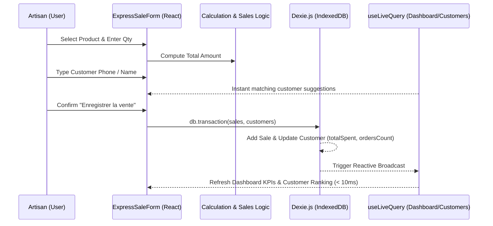

# 🏗️ Frontend Architecture — FereWari

## 1. Architectural Patterns & Directory Conventions
- **Framework**: React 18 + TypeScript + Vite.
- **Routing**: `@ionic/react-router` + `react-router-dom` with Ionic `<IonReactRouter>`, `<IonTabs>`, and `<IonRouterOutlet>`.
- **State Management Strategy**:
  - **Persistent Relational State**: Handled natively by Dexie.js in IndexedDB.
  - **Reactive UI Binding**: `useLiveQuery` hook from `dexie-react-hooks` which automatically subscribes components to query changes and re-renders only when relevant tables mutate.
  - **Transient View State**: React local state (`useState`, `useReducer`, `useMemo`, `useCallback`) for modal open/close states, active filters, form inputs, and animations.

---

## 2. Directory Layout & Module Structure

```text
src/
├── components/
│   ├── common/
│   │   ├── Badge.tsx
│   │   ├── Button.tsx
│   │   ├── Card.tsx
│   │   ├── Input.tsx
│   │   ├── Modal.tsx
│   │   ├── StatCard.tsx
│   │   └── Toast.tsx
│   ├── layout/
│   │   ├── AppHeader.tsx
│   │   ├── BottomNav.tsx
│   │   └── PageContainer.tsx
│   ├── materials/
│   │   ├── RawMaterialFormModal.tsx
│   │   ├── RawMaterialCard.tsx
│   │   └── StockBadge.tsx
│   ├── recipes/
│   │   ├── ProductFormModal.tsx
│   │   ├── ProductCard.tsx
│   │   ├── CostBreakdownChart.tsx
│   │   └── MarginGauge.tsx
│   ├── sales/
│   │   ├── ExpressSaleForm.tsx
│   │   ├── SaleReceiptModal.tsx
│   │   └── SalesHistoryList.tsx
│   ├── customers/
│   │   ├── CustomerRankingTable.tsx
│   │   └── CustomerHistoryModal.tsx
│   ├── subscription/
│   │   ├── GracePeriodBanner.tsx
│   │   ├── PaywallModal.tsx
│   │   ├── PaymentModal.tsx
│   │   └── DevSubscriptionToggle.tsx
│   └── backup/
│       ├── BackupCard.tsx
│       ├── GoogleDriveCard.tsx
│       └── RestoreModal.tsx
├── db/
│   ├── db.ts                  # Dexie database class & table typings
│   ├── seed.ts                # Initial demo data for first launch
│   └── useDbInit.ts           # Hook to initialize singleton settings & seed
├── hooks/
│   ├── useSubscription.ts     # Real-time subscription state evaluator
│   └── useDebounce.ts         # Fast search input debounce
├── services/
│   ├── calculationService.ts  # CRU, margin & BOM math
│   ├── subscriptionService.ts # Trial/Grace/Active logic
│   ├── backupService.ts       # JSON export & import
│   └── driveService.ts        # Client-side Google Drive sync
├── pages/
│   ├── DashboardPage.tsx
│   ├── RawMaterialsPage.tsx
│   ├── RecipesPage.tsx
│   ├── SalesPage.tsx
│   ├── CustomersPage.tsx
│   └── SettingsPage.tsx
├── styles/
│   └── index.css              # Tailwind imports, Ionic theme overrides, custom fonts
├── App.tsx                    # Ionic App root & Router setup
└── main.tsx                   # React root entry point
```

---

## 3. Data Flow & Reactive Rendering



---

## 4. Performance & Offline Strategy
- **Service Worker**: Configured via `vite-plugin-pwa` with `CacheFirst` for static assets and `StaleWhileRevalidate` for font files.
- **Bundle Splitting**: Dynamic code loading for heavyweight modals.
- **Micro-Animations**: Framer-motion used with CSS hardware-accelerated transforms (`transform: translate3d`).

---

## 5. Frontend Architecture Gate Status
- **Status**: **PASS (READY)**
- **Next Phase**: `11 — implementation`
- **Blockers**: None
