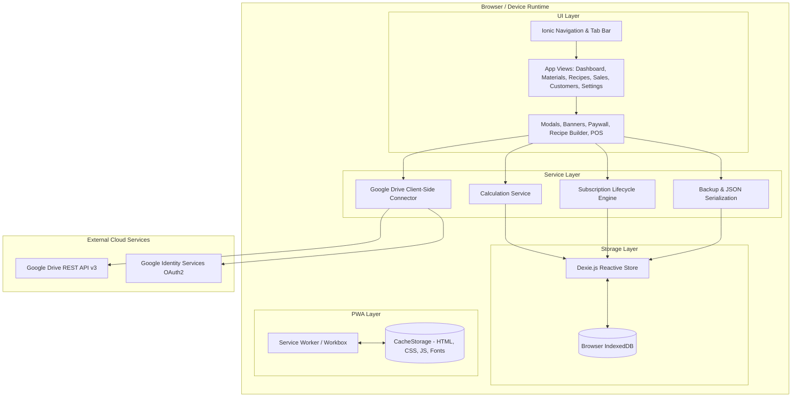

# 🏛️ System Architecture — FereWari

## 1. Architectural Style & Principles
- **Architecture**: 100% Client-Side Single Page Progressive Web Application (PWA).
- **Core Principles**:
  1. **Offline-First Resilience**: All business logic and read/write operations execute against local storage without network roundtrips.
  2. **Data Sovereignty**: The user's device is the primary, master database.
  3. **Reactive State Synchrony**: UI views automatically react to IndexedDB mutations via reactive live queries (`dexie-react-hooks`).
  4. **Modularity & Loose Coupling**: Independent feature domains (Materials, Recipes, Sales, Customers, Monetization, Backup) communicating through strongly typed domain services.

---

## 2. High-Level System Architecture

---

## 3. Component Boundaries & Responsibilities

| Subsystem | Primary Responsibility | Key Interfaces / Modules |
| :--- | :--- | :--- |
| **PWA & Offline Core** | Asset caching, offline boot, installation prompt | `vite-plugin-pwa`, `sw.js`, `manifest.json` |
| **Data Persistence** | ACID storage of all entities, reactive observation | `db.ts`, `FereWariDatabase`, `useLiveQuery` |
| **BOM & Cost Calculation** | Computes CRU, gross margins, and cost distributions | `calculationService.ts` |
| **Sales & POS Engine** | Fast checkout, auto-customer mapping, atomic ledger updates | `SalesPage.tsx`, `CustomerRankingTable.tsx` |
| **Monetization Engine** | Trial evaluation, grace period timer, paywall lock | `subscriptionService.ts`, `PaywallModal.tsx` |
| **Backup & Cloud Sync** | Export/import JSON blobs, OAuth2 Google Drive sync | `backupService.ts`, `driveService.ts` |

---

## 4. System Architecture Gate Status
- **Status**: **PASS (READY)**
- **Next Phase**: `07 — database-design`
- **Blockers**: None
