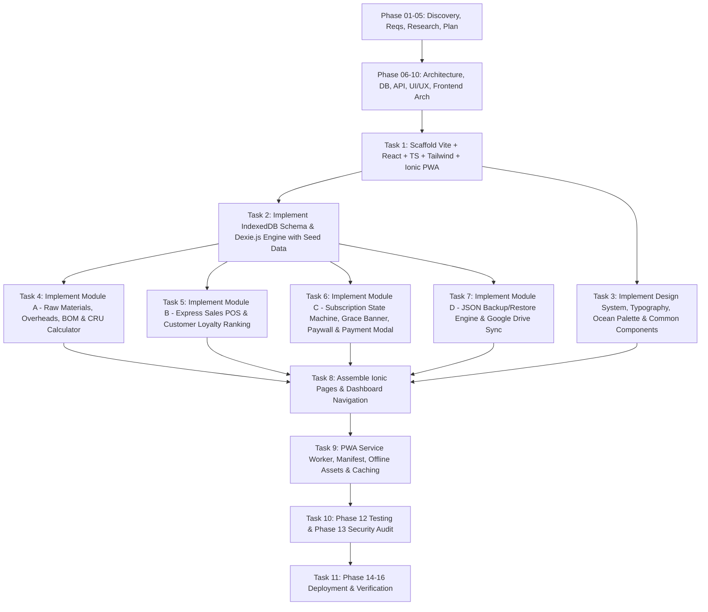

# 🗺️ Task Planning & Execution Roadmap — FereWari

## 1. Planning Objective
Deliver a production-ready, beautiful, 100% offline-first PWA for **FereWari** encompassing all functional modules (Production Costs/BOM, Express Sales, Customer Loyalty Ranking, Monetization & Paywall Lifecycle, JSON Backup & Google Drive Sync) conforming strictly to the Brand Guidelines and design tokens.

---

## 2. Work Breakdown Structure (WBS) & Task Dependencies

---

## 3. Detailed Task Breakdown

### Milestone 1: Design & Architecture Specifications (Phases 06 to 10)
- **Task 1.1**: System Architecture (`docs/system-architecture.md`).
- **Task 1.2**: Database Design (`docs/database-design.md`).
- **Task 1.3**: API & Service Contracts Design (`docs/api-design.md`).
- **Task 1.4**: UI/UX Design & Brand Guidelines (`brand-guidelines.md` & `docs/ui-ux-design.md`).
- **Task 1.5**: Frontend Architecture (`docs/frontend-architecture.md`).

### Milestone 2: Project Scaffolding & Core Infrastructure
- **Task 2.1**: Initialize `package.json`, `tsconfig.json`, `vite.config.ts`, and PWA configuration.
- **Task 2.2**: Configure Tailwind CSS with customized colors (`#03045E`, `#023E8A`, `#0077B6`, `#0096C7`, `#00B4D8`, `#48CAE4`, `#90E0EF`, `#ADE8F4`, `#CAF0F8`, `#F8FCFE`, `#E63946`) and Google Fonts (`Darker Grotesque`, `Google Sans Flex`).
- **Task 2.3**: Set up Ionic React shell and routing.

### Milestone 3: Database & Services Layer
- **Task 3.1**: Implement `src/db/db.ts` with exact typed schema (`rawMaterials`, `products`, `customers`, `sales`, `settings`).
- **Task 3.2**: Implement realistic seed data in `src/db/seed.ts` (artisanal juices & cosmetics).
- **Task 3.3**: Implement CRU/BOM calculation engine in `src/services/calculationService.ts`.
- **Task 3.4**: Implement Subscription Lifecycle Service in `src/services/subscriptionService.ts`.
- **Task 3.5**: Implement Backup/Restore Service in `src/services/backupService.ts` and Google Drive client in `src/services/driveService.ts`.

### Milestone 4: Feature Modules & Presentation Components
- **Task 4.1**: Build Module A (Raw Materials management, Finished Product BOM recipe builder, Cost visualizer).
- **Task 4.2**: Build Module B (Express Sales form, customer auto-completion, Customer Loyalty ranking table).
- **Task 4.3**: Build Module C (Top Grace period banner with countdown, Paywall modal with data reassurance, Mobile money payment dialog with Wave/Orange Money, Dev state toggle).
- **Task 4.4**: Build Module D (Backup & restore manager, 7-day reminder, Google Drive sync card).
- **Task 4.5**: Build Dashboard Overview (KPI cards: revenue, sales count, top product, active profit margins, quick actions).

### Milestone 5: Quality, PWA Verification & Lifecycle Completion
- **Task 5.1**: Phase 12 Testing (functional verification, unit logic, manual walkthrough).
- **Task 5.2**: Phase 13 Security Review (local storage safety, OAuth token handling, input sanitization).
- **Task 5.3**: Phase 14-16 Deployment preparation, verification, and monitoring guidelines.

---

## 4. Task Planning Gate Status
- **Status**: **PASS (READY)**
- **Next Phase**: `06 — system-architecture`
- **Blockers**: None
