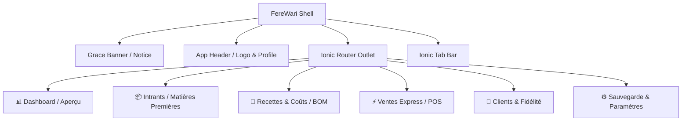

# 🎨 UI/UX Design Specifications — FereWari

## 1. User Experience Strategy
- **Core Paradigm**: Mobile-First, Ergonomic Touch Targets, One-Handed Usability, Low Cognitive Load.
- **Key User Flows**:
  1. **Quick Recipe & CRU Estimation**: Select ingredients $\rightarrow$ adjust quantities $\rightarrow$ input packaging & transport $\rightarrow$ instant CRU & Gross Margin gauge.
  2. **Express POS Checkout**: Tap Product $\rightarrow$ enter Quantity $\rightarrow$ type Customer phone/name (auto-completed) $\rightarrow$ instant atomic sale record.
  3. **Customer Loyalty Review**: View sorted leaderboard of highest spenders and frequent buyers to prioritize morning production and delivery runs.
  4. **Subscription Journey**:
     - *Days 1-15*: Unobtrusive trial status pill in header/settings.
     - *Days 16-25*: Persistent soft-red banner with days countdown and payment trigger.
     - *Day 26+*: Friendly locking paywall modal explicitly assuring full data persistence.
  5. **1-Click Backup & Restore**: Export JSON to local storage/WhatsApp or sync with Google Drive.

---

## 2. Screen Hierarchy & Views

---

## 3. UI States & Micro-interactions
- **Success Celebrations**: Trigger celebratory confetti bursts upon registering large sales or activating monthly subscriptions.
- **Real-time Cost Gauges**: Color-coded margin badges:
  - $\ge 50\%$ Margin: Vibrant Green / Cyan badge (`#00B4D8`).
  - $25\% - 49\%$ Margin: Soft Blue badge (`#0077B6`).
  - $< 25\%$ Margin: Warning Amber badge (`#F59E0B`).
  - $\le 0\%$ Margin (Selling at a loss): Critical Red alert (`#E63946`).
- **Empty States**: Encouraging illustrations and quick action buttons ("Ajouter ma première matière première", "Créer ma première recette").

---

## 4. UI/UX Design Gate Status
- **Status**: **PASS (READY)**
- **Next Phase**: `10 — frontend-architecture`
- **Blockers**: None
